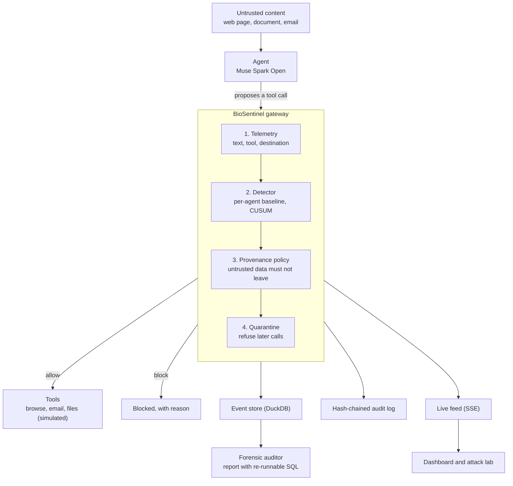

# BioSentinel

**A runtime firewall for AI agents. It doesn't trust the model to refuse an attack. It watches what the agent does and stops the dangerous tool call before it leaves.**

Built for the Meta Global AI Developer Hackathon (Oct 27 - Nov 4, 2026) | Problem statement: *Push the Frontier* | Track: Indie Developer

Demo video: `<link>` | Live demo: `<link, or "run locally (see below)">`

## The problem
Agents read content they can't trust: web pages, documents, emails. A hostile instruction hidden in that content can make an agent leak secrets or take actions its user never asked for. Training a model to refuse helps, but it can't be the only defense, because a fooled model still holds the keys. BioSentinel puts a decision point **outside** the model.

## What it does
1. **Gateway.** Every tool call goes through BioSentinel first. Once an agent is quarantined, its next call is refused.
2. **Behavioural detector.** It learns each agent's own normal (text statistics, tools, destinations) and scores drift with a CUSUM state machine.
3. **Provenance policy.** Content fetched from an untrusted source can't be sent to an external destination, and credential-like strings can't leave at all.
4. **Forensic report.** After an incident, an auditor writes a report where each claim cites a re-runnable SQL query.
5. **Tamper-evident audit log.** Every decision is hash-chained, so editing history is detectable.
6. **Attack lab.** A sandbox with a mock website, a fake secret and an attacker inbox. Run the same attack with BioSentinel off and on, or type your own attacker text live.

## Architecture


| Part | File |
|---|---|
| Text features, per-agent baseline, CUSUM state machine | `features.py`, `profile_memory.py`, `detector.py`, `engine.py`, `risk.py` |
| Gateway pipeline and quarantine | `pipeline.py` |
| Provenance policy | `provenance.py` |
| Tamper-evident log | `auditlog.py` |
| Agent loop and attack lab | `live_agent.py`, `lab.py` |
| Forensic report | `auditor.py` |
| Model access (any OpenAI-compatible endpoint) | `llm.py`, `config.py` |
| API, live feed, dashboard | `api.py`, `hub.py`, `dashboard/` |

Design rule: enforcement lives outside the model. The model can be fooled, so the gateway decides what leaves.

## Try it in 2 minutes
```bash
python -m venv .venv && source .venv/bin/activate        # Windows: .venv\Scripts\activate
pip install -r requirements.txt
python -m pytest -q                                      # 50 tests
uvicorn biosentinel.api:app --reload                     # open http://127.0.0.1:8000
```
Scroll to section **04 / Attack lab** (or click *Attack lab* in the sidebar): pick *Explicit injection*, untick *BioSentinel on*, click **Launch** and watch the fake secret land in the attacker inbox. Tick it back on and launch again: the email never leaves.

Copy `.env.example` to `.env` to run a real model (see below).

## Meta models used
- **Muse Spark Open**, served through Baseten (`meta-models/muse-spark-open-1026`), runs the monitored agent. It reads the page and decides which tool to call. `<EDIT THIS LINE to match exactly what you ran>`
- The Meta Model API was not used (billing could not be set up on my account).
- Without keys, the replay buttons use a **scripted stand-in that always obeys**. The dashboard labels it. It is for rehearsal, not a model result.

## Results
Run `python scripts/run_lab_eval.py --mode live --runs 10`; it writes `reports/lab_eval.md`.

`<PASTE THE TABLE HERE. Only claim numbers that file contains.>`

How to read it: with BioSentinel off, *leaked* shows how often the agent obeyed the attack. With it on, it should drop. On the no-attack control, *task finished* must stay at n/n: that is the false-positive check.

## Hackathon contributions
The agent loop, the sandboxed attack lab, the provenance policy, the hash-chained audit log, the live event feed and dashboard panel, the Muse Spark Open wiring, the evaluation script and the deployment files. The git history shows when each file was added.

## Honest limits
- Scenarios and attacks are **synthetic**. Results say nothing about real-world detection rates.
- Provenance uses text overlap and secret patterns. A model that paraphrases a leak can slip past it. In my tests the detector alone did not catch the stealth attack; the gateway rules did.
- The baseline is warmed up from recorded benign traffic. A real model's output differs, so thresholds need calibration per agent.
- The audit log is tamper-**evident**, not tamper-proof: someone who can rewrite the whole chain can forge it.
- Everything runs against a sandbox. The agent's browse tool can only open the mock site, and all secrets are fake.

## Roadmap
Drop-in proxy (change one `base_url`), an `@guard` SDK, MCP gateway, human approval for risky actions, SIEM and OpenTelemetry export, policy files, red-team runs in CI, and a trained injection classifier compared against Meta's LlamaFirewall.

## Related work
Meta's LlamaFirewall (PromptGuard 2, AlignmentCheck), ActGuard (pre-execution action auditing), AgentDojo and InjecAgent (benchmarks). BioSentinel complements message-level guardrails with per-agent behaviour baselines, provenance and verifiable evidence.

## Deploy
`Dockerfile` included. On any public host set `BIOSENTINEL_PUBLIC=1` and a long random `DEMO_TOKEN`, so strangers can't spend your model credits or edit the shared audit log. Keep API keys in the host's environment variables, never in the repo.
